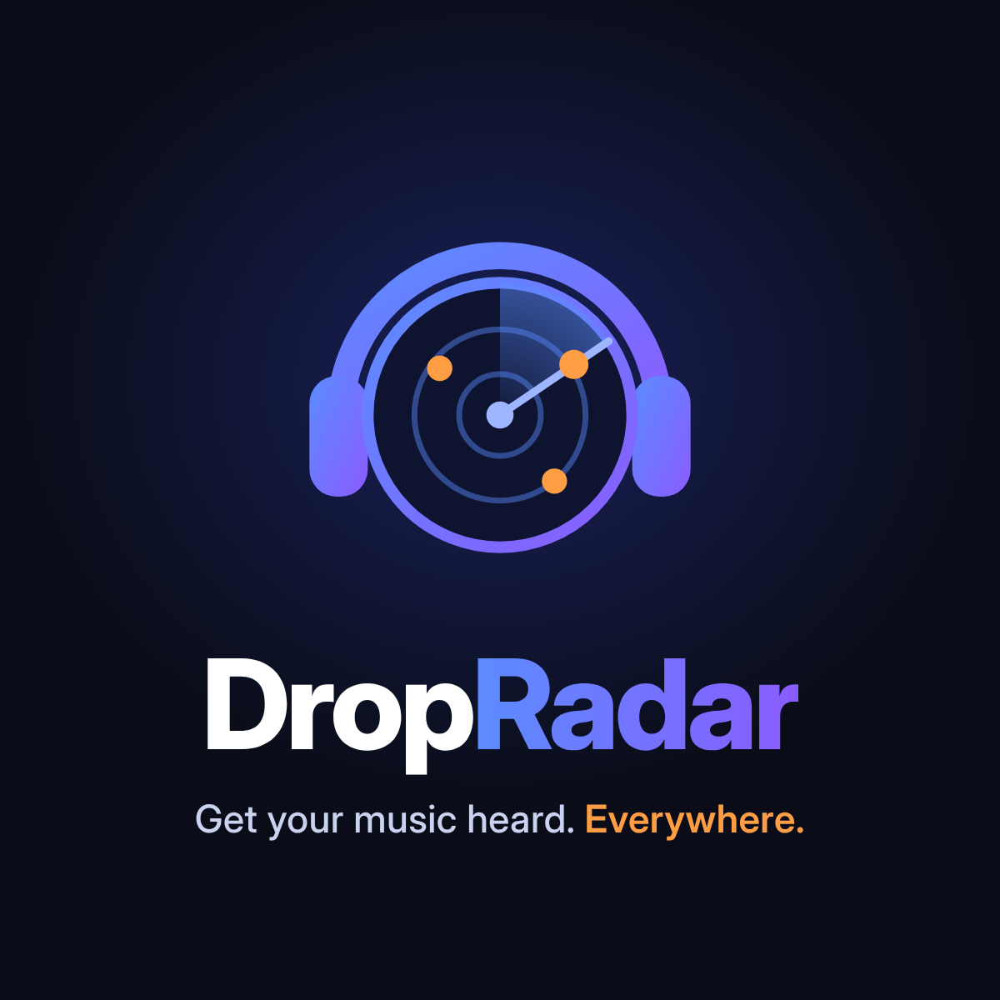
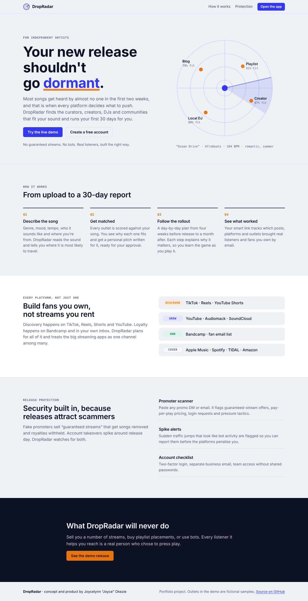
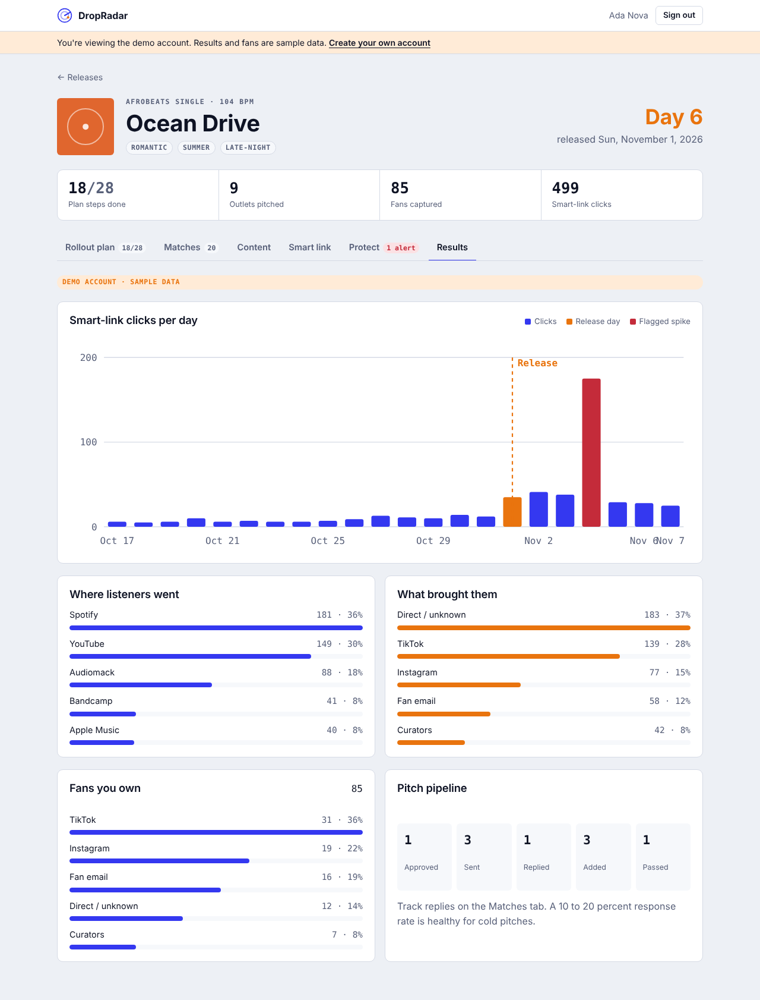
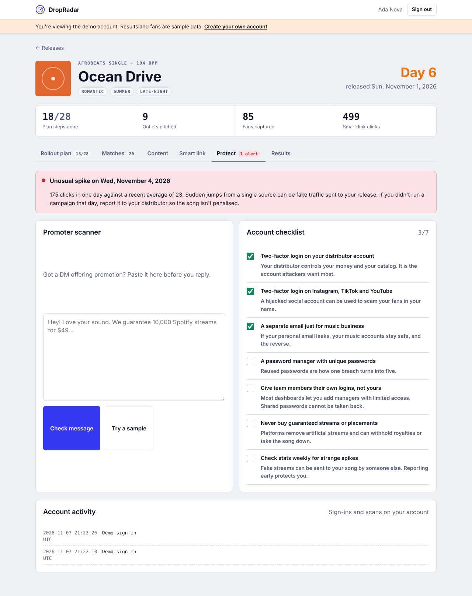

<p align="center"></p>

# DropRadar

**Keeps new music releases from going dormant.**

**Live demo:** https://dropradar-bv2c.onrender.com (choose *Try the live demo*; the free server may take about 30 seconds to wake up)

Most independent releases get heard by almost no one in their first two weeks, which is exactly when every platform decides what to push. DropRadar matches a song with the curators, creators, DJs and communities that fit its sound, runs a 30-day rollout plan, collects fans through a smart link, and protects the release from fake-stream scams.

> Concept, product design and security requirements by **Joycelynn "Joyce" Okezie** ([@TechLady93](https://github.com/TechLady93)).
> Built with AI-assisted development (Claude Code), directed and reviewed by me.



## Why I built it

I spent 15+ years in independent music, A&R and creative strategy, and I watched good records disappear because nobody heard them in the first few weeks. The tools that exist are usually tied to one distributor or one platform, or they sell "guaranteed streams" that get songs removed. I wanted something that:

- works across **every** platform, not just Spotify
- helps artists build **fans they own** (email list, Bandcamp) instead of streams they rent
- **teaches** the reasoning behind each step
- treats **security** as a feature, because releases attract scammers

## What it does

| Feature | Description |
|---|---|
| **Release analyzer** | Scores short-form video fit from genre, mood and tempo, and recommends where the song is most likely to travel |
| **Outlet matching** | Scores every playlist, blog, creator, DJ, radio show and community against the song (0–100) and explains why each one fits |
| **Pitch writer** | Generates a personalized pitch for each outlet, for the artist to edit and approve. Nothing is sent automatically |
| **30-day rollout plan** | 28 dated steps from four weeks before release to 30 days after, each with a plain-language "why" |
| **Content kit** | Captions per platform, short-form video ideas and hashtags |
| **Smart link** | One public page per release with platform buttons, fan email capture and source tracking (`?src=tiktok`) |
| **Results dashboard** | Clicks per day, platforms, traffic sources, fans captured and the pitch pipeline |
| **Release Protection** | Promoter-message scam scanner, traffic-spike alerts, account security checklist and an account activity log |



## Security design

Security is a core requirement, not an afterthought. This is the part of the project closest to my cybersecurity studies (CompTIA Security+, Cybersecurity Management at NSU).

**Application security**
- **Passwords** hashed with bcrypt (cost 12). Minimum length and complexity enforced.
- **Sessions** use signed JWTs in `HttpOnly`, `SameSite=Strict`, `Secure` (in production) cookies, so scripts can't read them.
- **Brute-force protection:** accounts lock for 15 minutes after 5 failed sign-ins, plus IP-based rate limiting on auth endpoints.
- **No account enumeration:** login returns the same message and the same timing whether or not the email exists.
- **CSRF defence:** state-changing requests require a custom header that browsers can't send cross-site without a preflight, alongside strict SameSite cookies.
- **Access control:** every release query is scoped to the signed-in user, preventing insecure direct object references (IDOR).
- **XSS defence:** all user content is escaped before rendering, and a strict **Content-Security-Policy** (no inline scripts or styles) is set with Helmet, along with HSTS, `nosniff` and frame-ancestors `none`.
- **Open-redirect prevention:** smart-link destinations must be `https` links on the platform's own domain (a YouTube button can only point to youtube.com).
- **Input validation** on every field, request body size limits, and error responses that never leak stack traces.
- **Bot defence** on the public fan form: honeypot field plus rate limiting.
- **Audit log** of sign-ins, failures, lockouts and scans, visible to the user.

**Protecting artists (the product's security features)**
- **Promoter scanner:** flags the patterns behind fake-stream services and scams: guaranteed stream counts, pay-per-stream pricing, paid placement on editorial playlists, requests for passwords or login codes, untraceable payment methods, fake "platform staff" messages, pressure tactics and shortened links.
- **Spike detection:** flags any day with more than 4× the trailing 7-day average, the pattern artificial-streaming campaigns leave behind, so the artist can report it before the platform penalizes the release.
- **Account checklist:** two-factor login, separate business email, password manager, team access without shared passwords.



### What DropRadar will never do

Sell a number of streams, buy playlist placements, or use bots. Spotify and other platforms remove artificial streams and can withhold royalties or take songs down, so the product is designed around real listeners only.

## Tech stack

- **Back end:** Node.js 22, Express, built-in `node:sqlite` (no native build step), bcryptjs, jsonwebtoken, Helmet, express-rate-limit
- **Front end:** HTML, CSS and vanilla JavaScript (no framework, no build step), light and dark themes, mobile-first
- **Engine:** rule-based matching and generation, so the app runs free with no AI API key. Each engine function is a clean seam where a hosted AI model can be added later.

```
server/
  index.js    API routes, auth, security middleware
  engine.js   analysis, matching, rollout plan, pitches, content, scam scanner
  db.js       SQLite schema
  seed.js     sample outlets and demo account
public/
  index.html  landing page
  app.html    artist app (js/app.js)
  link.html   public smart link (js/link.js)
```

## Run it locally

Requires Node.js 22.13 or newer.

```bash
git clone https://github.com/TechLady93/DropRadar.git
cd DropRadar
npm install
npm start
```

Open http://localhost:3000 and choose **Try the live demo**.

Demo login: `demo@dropradar.app` / `DemoDrop!2026`

## Deploy for free (Render)

1. Sign in at [render.com](https://render.com) with GitHub.
2. **New → Web Service**, then pick this repository.
3. Build command `npm install`, start command `npm start`, instance type **Free**.
4. Under **Environment**, add:
   - `NODE_ENV` = `production`
   - `JWT_SECRET` = a long random string
   - `PUBLIC_URL` (optional) = your custom domain, if you add one
5. Deploy. Free instances sleep when idle, so the first load can take about 30 seconds.

The free tier doesn't keep files between restarts, so the database resets to the demo data. That's ideal for a portfolio demo. For real users, point `DB_PATH` at a persistent disk or move to a hosted database.

## Notes on the demo data

All outlets in the demo are **fictional samples**. Clicks, fans and the traffic spike on the demo release are generated sample data, labelled as such in the app.

## Roadmap

- Swap the rule-based engine for an AI model for genre and mood tagging and pitch writing
- Real outlet directory with curator opt-in
- Email delivery for fan lists and plan reminders
- Two-factor login for DropRadar accounts
- Optional subscription after a free first month

## License

MIT
